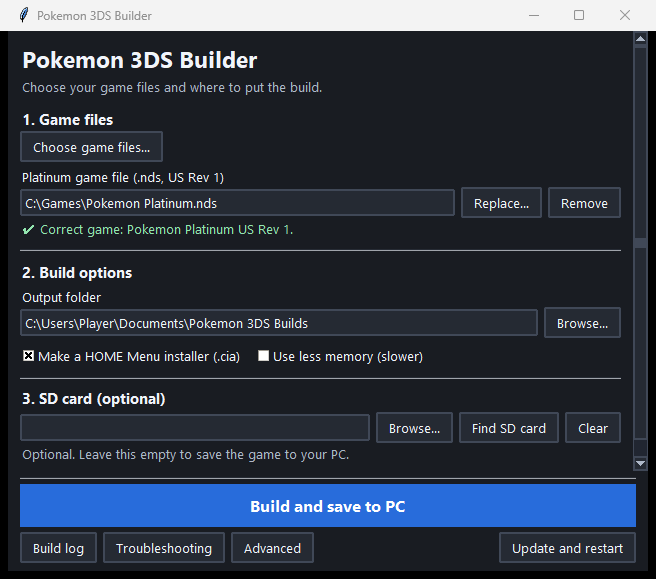

<h1 align="center">Pokémon 3DS Builder</h1>

Build Pokémon Platinum, SoulSilver, or HeartGold from your own cartridge dump for a New Nintendo 3DS.

<strong><a href="https://github.com/unowncollectables/patch-builder/releases/latest/download/Pokemon3DSBuilder.exe">Download for Windows</a></strong> · <a href="#quick-start">Quick start</a> · <a href="#troubleshooting">Troubleshooting</a>

## Quick start

You’ll need Windows 10 version 2004 or later or Windows 11, internet access, and about 15 GB of free space. To play, you’ll need a **New Nintendo 3DS, New Nintendo 3DS XL, or New Nintendo 2DS XL** with custom firmware. Your cartridge dump stays on your computer.

1. Open **Pokemon3DSBuilder.exe** and click **Choose game files**. Pick your US `.nds` file. Platinum requires a clean, untrimmed **Rev 1** dump. You can select more than one game.
2. To copy the finished game to your 3DS SD card, insert the card and click **Find SD card**. If the builder finds multiple cards, use **Browse** to select the top level of the right one. Leave the SD card field empty to save the build to your PC.
3. Click **Build and install to SD** or **Build and save to PC**. On the first run, Windows may ask to install WSL and Ubuntu. Approve the prompt, restart if asked, then reopen the builder and press Build again. If Ubuntu asks you to create a Linux username and password, finish that prompt first.
4. Open the game in **Homebrew Launcher**. If you enabled **Make a HOME Menu installer (.cia)**, you can also open **FBI** on the console and install the game’s `.cia` from the SD card’s `cias` folder.

The first build can take an hour or more. The builder downloads the game project and sets up the tools for you. Finished files also go to **Documents → Pokemon 3DS Builds** by default. Click **Open output folder** to find them and the installation instructions.

> [!NOTE]
> HeartGold is experimental. It has its own output folder, HOME Menu title, and save file, so you can install it alongside SoulSilver.

## Update the builder

Starting with **v1.3.17**, the Windows app shows **Update and restart** when a newer version is available. Click it when you’re finished building. The app verifies the download, replaces the executable, and reopens with your saved settings.

If you’re on **v1.3.16 or older**, or the in-app update fails, close the builder and replace your copy with the latest executable. [Download for Windows](https://github.com/unowncollectables/patch-builder/releases/latest/download/Pokemon3DSBuilder.exe)

The **Build** button also checks for updates to the game projects. Use **Advanced → Offline** to skip that check, or **Advanced → Update and build** to check even while Offline is selected.

## Troubleshooting

- **Compiler runs out of memory.** Check **Use less memory (slower)** under **Build options**, then press Build again.
- **Build tools fail to install.** Open **Troubleshooting → Check setup** or choose **Repair tools**. The builder downloads its verified devkitPro tools automatically.
- **Windows can’t start WSL.** Follow the builder’s one-time setup prompts. If it still reports that virtualization is off, enable Intel VT-x or AMD SVM in your PC’s BIOS or UEFI and restart.
- **The game file is rejected.** Read the message beneath the file. Use a clean US dump of the selected game, and make sure Platinum is untrimmed Rev 1.
- **The SD card is missing or write-protected.** Reinsert it and check the lock switch. You can clear the SD card field and save the build to your PC.
- **The builder offers Reset build cache.** Use it if the build keeps failing at the same step. It clears temporary build files, so the next build takes longer.
- **You still need help.** Click **Copy details for help** and paste the log into an issue. Include your builder version and the game you were building. Share the log only. [Open a GitHub issue](https://github.com/unowncollectables/patch-builder/issues)

<strong>Copy files to the SD card yourself</strong>

Open the game’s output folder. Copy its `.3dsx` and your own cartridge dump into the corresponding folder. Use the exact dump filename shown below. If your card already has your cartridge dump there, leave it in place.

| Game | SD card folder | Cartridge dump filename |
| --- | --- | --- |
| Platinum | `3ds/platinum3ds/` | `platinum.nds` |
| SoulSilver | `3ds/soulsilver3ds/` | `soulsilver.nds` |
| HeartGold | `3ds/heartgold3ds/` | `heartgold.nds` |

If you made a `.cia`, copy it to `cias/` and install it using **FBI**. If Platinum’s output contains `followers.bin`, copy it alongside the `.3dsx`.

The builder backs up existing saves in the game’s `save_backups/` folder before copying a build. **Troubleshooting → Delete old builds** previews the files it can remove.

<strong>Advanced options and Platinum followers</strong>

- To add following Pokémon to Platinum, select Platinum and use **Advanced → Add SoulSilver for Platinum followers** to choose a US SoulSilver dump. Building both games together also provides the SoulSilver file to Platinum.
- Leave project folders empty for automatic downloads into your Linux or WSL home. Choose a folder manually to use an existing checkout.
- **Advanced** includes manual game selection, Offline, Quick rebuild, Full build, and Test Platinum patches.

<strong>Run from source or use the command line</strong>

On Windows, install Python 3 with **Add Python to PATH** selected. Run `python p3ds_builder.py` to launch from source, or run `build_exe.bat` to package an executable. On Linux, install `python3-tk` and run `python3 p3ds_builder.py`.

Download a game project and run its build script. Replace the example paths with your own.

~~~sh
bash p3ds_get.sh platinum
P3DS_ROOT=~/3ds-platinum P3DS_PLATINUM=~/platinum.nds P3DS_OUT=~/3ds-builds P3DS_CIA=1 bash p3ds_build.sh all

bash p3ds_get.sh soulsilver
P3DS_ROOT=~/Pokemon-Soulsilver-New3ds P3DS_SOULSILVER=~/soulsilver.nds P3DS_OUT=~/3ds-builds P3DS_CIA=1 bash ss_build.sh all

bash p3ds_get.sh heartgold
P3DS_ROOT=~/Pokemon-HeartGold-New3ds P3DS_HEARTGOLD=~/heartgold.nds P3DS_OUT=~/3ds-builds P3DS_CIA=1 bash hg_build.sh all
~~~

Run the script’s `setup` step with administrator privileges on a fresh system. For example, run `sudo env P3DS_ROOT="$HOME/3ds-platinum" bash p3ds_build.sh setup` for Platinum. Use `check` to inspect the setup or `quick` to relink an existing build. Set `P3DS_SD` to copy directly to the card from Linux, or omit `P3DS_CIA` to skip the HOME Menu installer.

Maintainers can push a `v*` tag after updating the version in `p3ds_builder.py`. GitHub Actions builds the executable and attaches it to the release.

<strong>Work with Platinum patches</strong>

| Path in the Platinum project | Patch format |
| --- | --- |
| `work_patches/overlays/<folder>__<file>.c.patch` | Game source. Use flattened names such as `overlay005__fieldmap.c` in the file and diff headers. |
| `work_patches/overlays/include_<name>.patch` | Git-style header patch against `native-probe/pokeplatinum`, with paths such as `a/include/...`. |
| `work_patches/native/<anything>.patch` | Git-style patch to pspoke `port/` code, with paths such as `a/native-audio-app/platform.c`. |
| `pspoke-patches/NNNN-*.patch` | A commit made with `git format-patch`. Changes trigger a full build. |

The builder dry-runs the patches before applying them. New patches are applied, edited patches replace their prior versions, deleted patches are reversed, and unchanged patches are skipped. Use **Advanced → Test Platinum patches** to check them before building.

See [AGENTS.md](AGENTS.md) for repository conventions.

